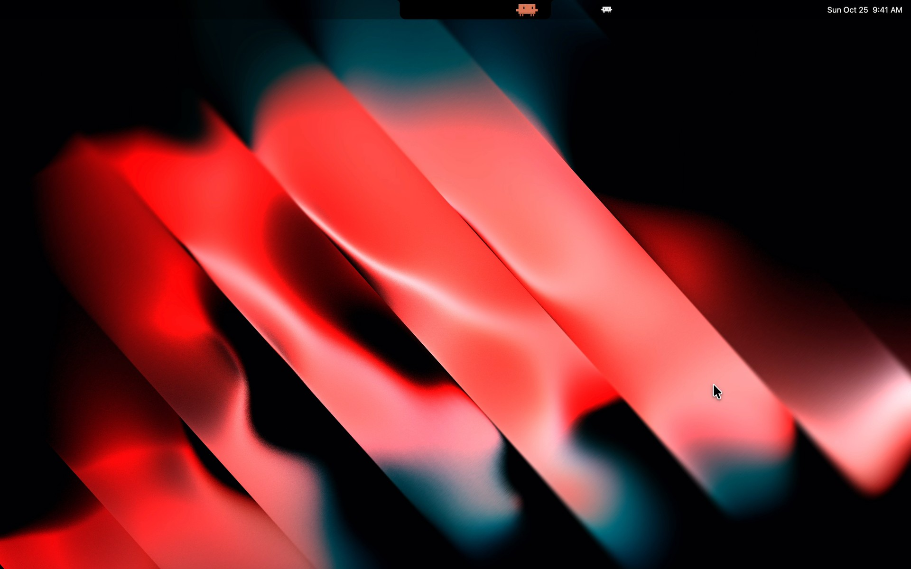
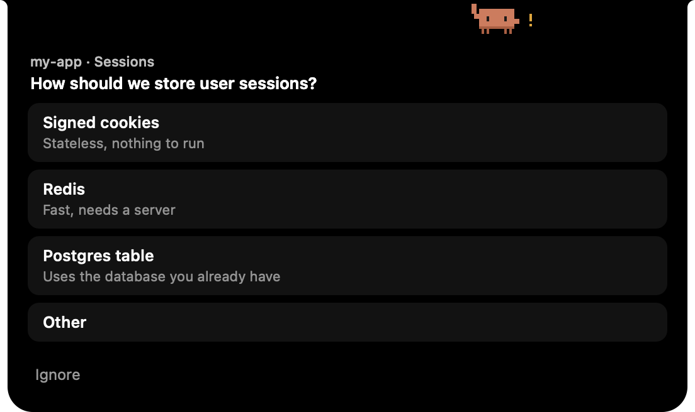
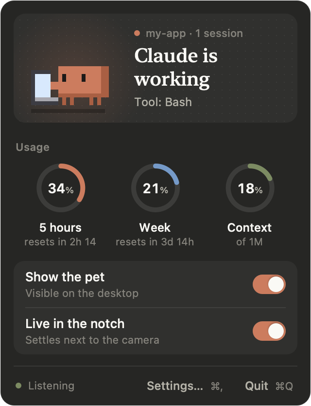
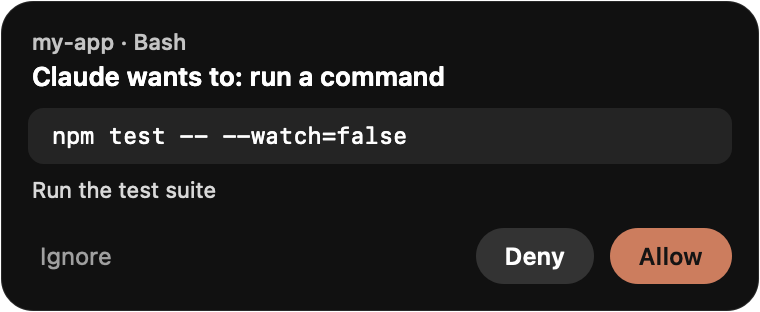

# Claude Pet

A pixel-art pet for macOS that lives in your MacBook's notch and reacts to what Claude Code is doing. It thinks while
Claude thinks, types on a tiny laptop while Claude runs commands, waves at you when Claude needs an answer, and naps
when nothing happens. When Claude asks for a permission or a question, you can answer right from the notch.

Works with the `claude` CLI and with the Code tab of Claude Desktop, through Claude Code's hooks. For Apple Silicon
Macs.



> **Not affiliated with Anthropic.** Claude Pet is an independent, unofficial project. "Claude" and "Claude Code" are
> trademarks of Anthropic, PBC.

## Install

1. Download **ClaudePet.dmg** from the [latest release](https://github.com/thomaslorenzini/claude-pet/releases/latest).
2. Open it and drag **Claude Pet** into Applications.
3. Open Claude Pet from Applications.

**macOS will block it the first time.** The app isn't signed with an Apple Developer ID yet, so Gatekeeper says it
can't check it for malware. To open it anyway, pick one:

- Open it once, then go to **System Settings › Privacy & Security**, scroll down and click **Open Anyway**.
- Or, in Terminal:

  ```bash
  xattr -dr com.apple.quarantine "/Applications/Claude Pet.app"
  ```

If you'd rather not trust a downloaded binary, [build it yourself](#build-from-source): it takes a minute and
Gatekeeper doesn't get in the way.

Requires a Mac with **Apple Silicon** (M1 or later) and macOS 13 or later. The download doesn't run on Intel Macs.
The notch mode needs a MacBook with a notch; elsewhere the pet floats on your desktop.

### First launch

A window lists everything that will be written before anything happens:

- the hooks, added to `~/.claude/settings.json` next to your own (nothing else in the file changes);
- a small relay for your status line, which forwards its data to the pet and then runs your original command, so your
  terminal looks the same;
- a few files in `~/Library/Application Support/claude-pet/`.

`settings.json` is backed up before every write. **Decline** quits without writing anything. Everything can be
repaired, uninstalled or restored later from **Settings › Claude Code**.

Sessions that were already open only see the hooks after a restart (or after opening `/hooks`).

## What it does



- **Reacts to Claude Code**: idle, thinking, working (with an icon for the tool: shell, edit, search, web, agent),
  error, waiting for you, happy when a task ends, asleep after 10 s of quiet. With several sessions open, it follows
  the one that matters most: one that needs you is never hidden behind one that is working.
- **Answers Claude for you**: permission requests (**Allow** once, **Deny**, or **Ignore** to answer in Claude) and
  `AskUserQuestion` prompts, including multiple choice and a free-text **Other**. Claude Code keeps the first answer
  it gets, wherever it comes from: the pet, the terminal, Desktop.
- **Shows your usage**: hover the notch to see your 5-hour quota, your weekly quota and the current session's
  context window.
- **Lives in the notch or floats**: drag it into the notch and out again, or toggle it from the menu bar.
- **Stays out of the way**: clicks go through it everywhere except on the pet itself, it uses no CPU while asleep and
  about 0.4 % awake.

<p align="center">
  
  
</p>

The interface is in English or French, following your system language.

## Privacy

- Everything stays on your Mac. The app talks to Claude Code over `127.0.0.1` only and refuses requests from web
  pages.
- **Account quotas are off by default.** If you turn them on (first-launch checkbox, or **Settings › Data**), the app
  reads the login token Claude Code keeps in your Keychain and asks Anthropic's usage endpoint for your quotas every
  5 minutes. The token stays in memory: it is never written, logged or sent anywhere else. When it has expired, the
  app runs `claude -p /usage` so Claude Code renews it itself; this sends no request to the model and uses no quota.
  This endpoint is not an official API and may stop working at any time.
- Without quotas turned on, the gauges still fill in from your status line (CLI sessions) and the session
  transcript (context only).

## Uninstall

**Settings › Claude Code › Uninstall** removes the hooks and puts your status line back, then drag the app to the
Trash. `~/.claude/settings.json.claude-pet-original` is the copy of your settings from before the first install.

## Build from source

You need macOS 13+ and Swift 5.10+. The Command Line Tools are enough (`xcode-select --install`), Xcode isn't
needed.

```bash
git clone https://github.com/thomaslorenzini/claude-pet.git
cd claude-pet
scripts/bundle.sh
open build/ClaudePet.app
```

`scripts/bundle.sh` builds in release mode and wraps the binary in `build/ClaudePet.app` (no Dock icon). Move it to
Applications if you want it to open at login.

Other scripts:

| Command | What it does |
|---|---|
| `swift run ClaudePet` | Runs the debug build (quit any running Claude Pet first) |
| `scripts/make-dmg.sh` | Builds `build/ClaudePet.dmg`, with the drag-to-Applications window |
| `scripts/fake-event.sh demo` | Plays fake Claude Code events, no Claude needed (`multi`, `stop`, `state`… without an argument for the list) |
| `scripts/install-hooks.py install --dry-run` | The hook installer as a script, for development (shows the diff) |
| `scripts/measure-cpu.sh` | Measures CPU and memory in each state |
| `scripts/make-icon.sh` | Regenerates the app icon from the sprite |

The version comes from the latest `vX.Y.Z` git tag (or `VERSION=1.2.3 scripts/bundle.sh`).

## How it works

```
Claude Code ──hook──▶ curl POST 127.0.0.1:47319/event ──▶ Claude Pet ──▶ sprite
```

Each hook reads the port from `~/Library/Application Support/claude-pet/endpoint` and checks that the pet is running
with shell built-ins only. When the pet is closed, no process is started and the hook exits at once. Otherwise it
sends the hook's JSON with `curl -m 1` and always exits 0, so a stuck pet can never block Claude for more than a
second. Permission requests are the exception: that hook waits for your answer in the pet, and Claude Code shows its
own dialog at the same time.

The app is a Swift package with no dependencies (AppKit only). The sprites are drawn in code
(`Sources/ClaudePet/Sprites.swift`).

### Local API

For scripts and mods, on `127.0.0.1:47319` (the port can change if it's taken, see the `endpoint` file):

- `POST /event`: a Claude Code hook's JSON as is, or a forced state:
  `{"session_id": "x", "pet_state": "happy", "pet_tool": "bash", "pet_duration": 2}`
  (`pet_state`: `idle|thinking|working|error|waiting|happy|sleeping`; `pet_tool`: `bash|edit|read|web|agent|other`).
- `POST /control`: `{"notch": true}` moves the pet into the notch (`false` brings it out).
- `GET /state`: current state and sessions. `GET /health`: is the app running.

## Contributing

Claude Pet is developed by one person, and that's how it will stay for now: **issues are welcome, pull requests
aren't accepted.** Bug reports, ideas and feedback are the most useful help. The app has been tested on one MacBook
with a notch, so reports from other setups (no notch, external displays, other macOS versions) help a lot.

## License

Copyright © 2026 Thomas Lorenzini.

Claude Pet is free software under the [GNU General Public License v3.0](LICENSE): you can use, study, modify and share
it, as long as anything you distribute based on it stays under the GPL, with its source code and this copyright
notice.
